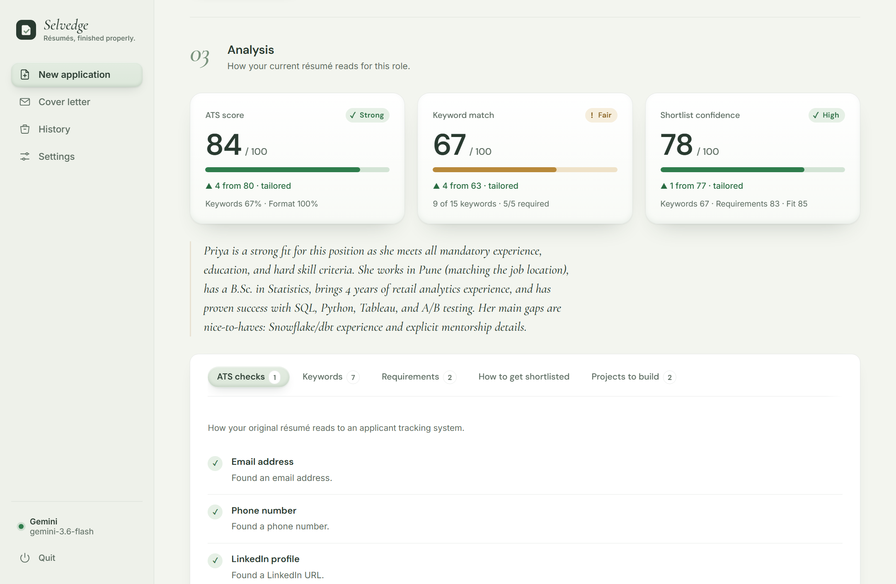
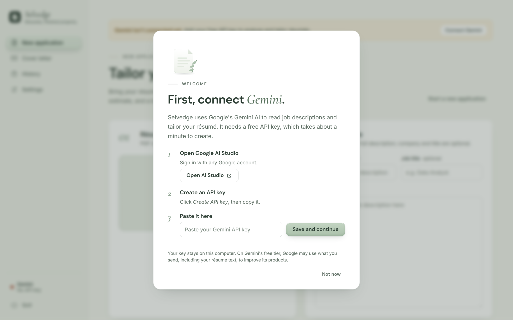
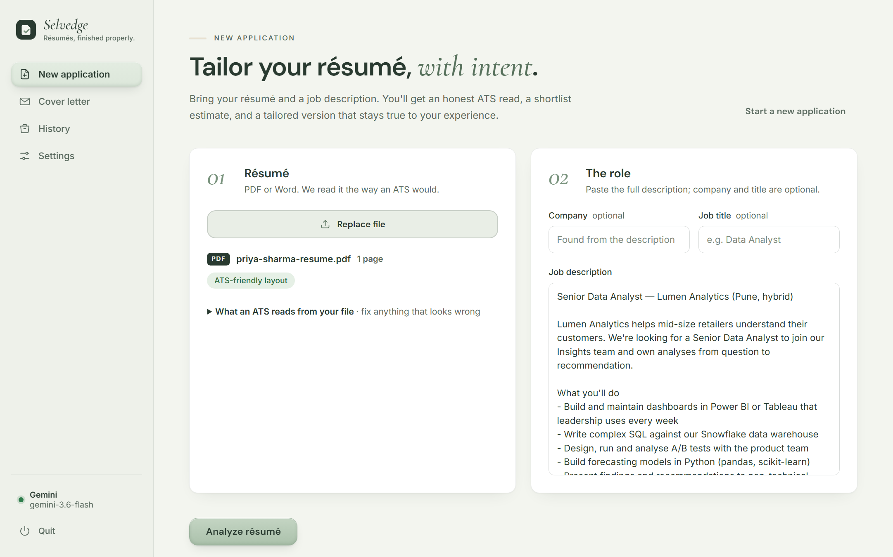
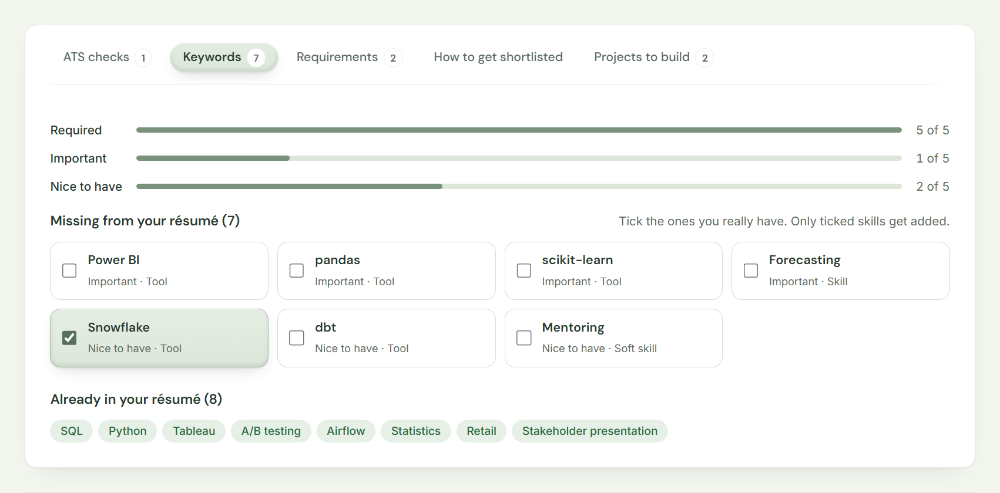
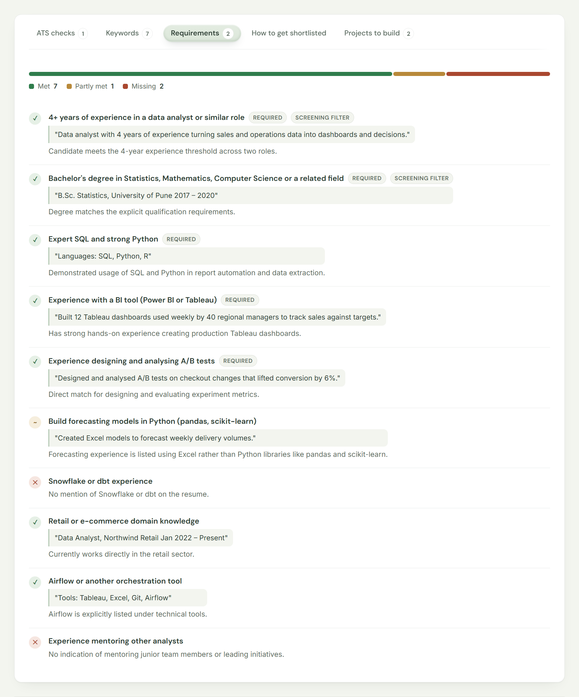
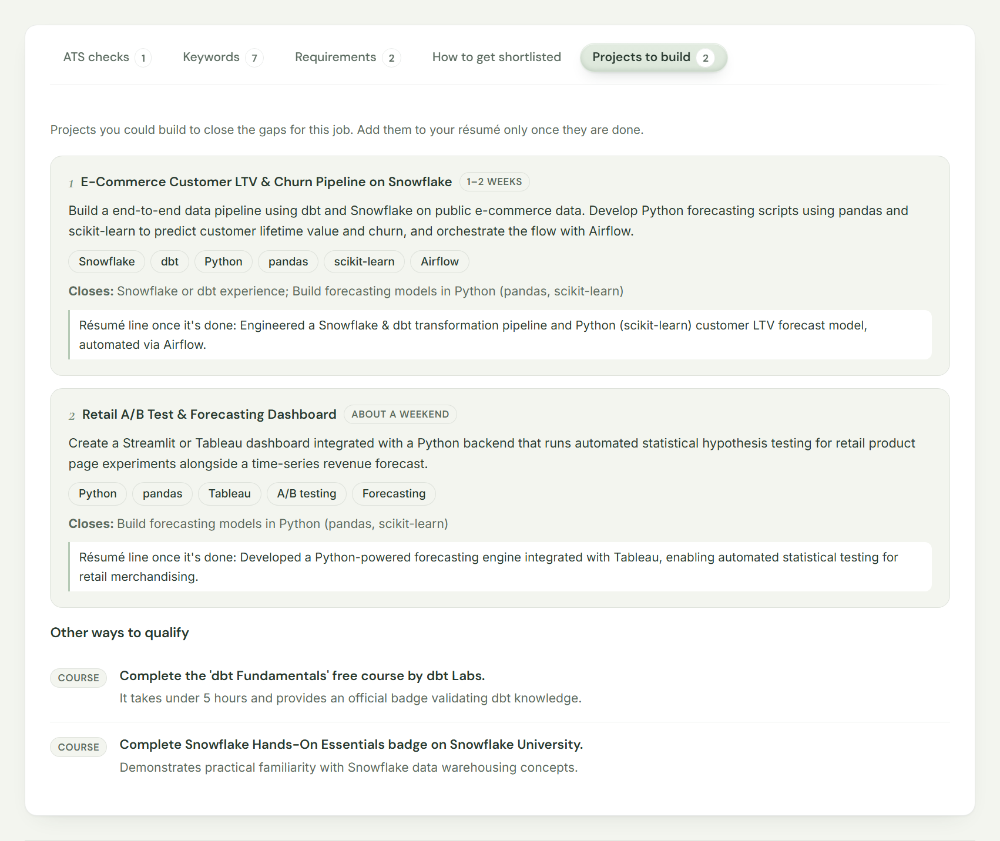
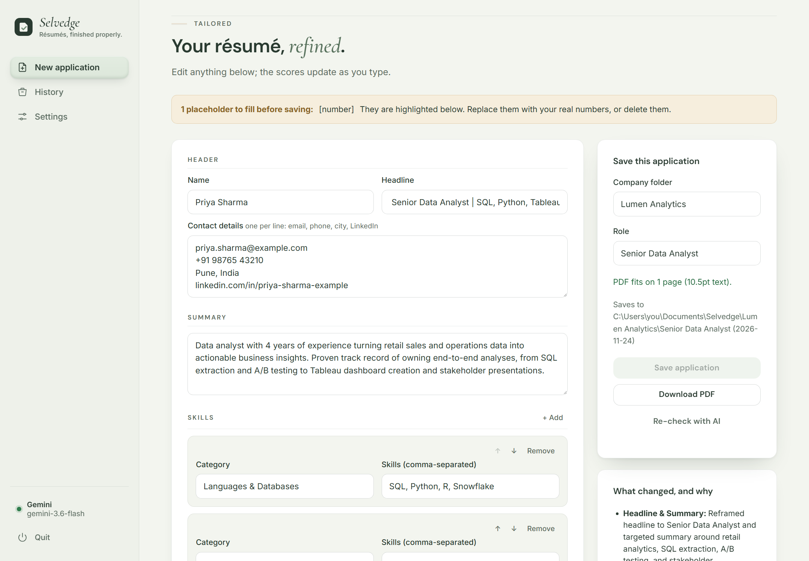
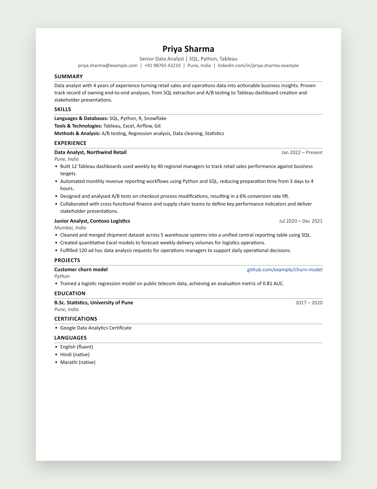
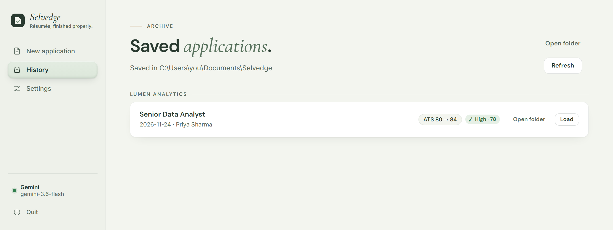

<div align="center">


# Selvedge

**Résumés, finished properly.**

Tailor your résumé to any job description, with an honest ATS read, a shortlist estimate,<br>
and a tailored version that never invents a single line.

[](https://github.com/iffayush/selvedge/releases/latest)
[](#install)
[](#models-privacy-and-cost)
[](LICENSE)

**[Download for Windows](https://github.com/iffayush/selvedge/releases/latest)** · [How it works](#how-it-works) · [Example](#a-real-example) · [FAQ](#faq)

<sub>by <a href="https://github.com/iffayush">@iffayush</a></sub>

<br>



</div>

---

## Why Selvedge

Most résumés are rejected before a person reads them, by an applicant tracking system (ATS) that can't parse the layout, or by a recruiter scanning for keywords that aren't there. The usual fix, "ask an AI to rewrite it", has a nasty side effect: AI tools happily invent skills, round up numbers and pad your experience. That's exactly what unravels in an interview.

Selvedge does the tailoring **and** checks the result against your original:

| | |
|---|---|
| **Reads it like an ATS** | Extracts your résumé the way an ATS would, and checks contact details, headings, layout, metrics, action verbs and dates. |
| **Scores your chances** | ATS score, keyword match and shortlist confidence, each with its breakdown, before and after tailoring. |
| **Tells you what to do** | Missing keywords, unmet requirements, prioritised tips, and concrete **projects to build** to close your gaps. |
| **Tailors, honestly** | Rewrites for the role using only what's true, and flags any skill or number that wasn't in your original. |
| **Finishes the job** | Exports a one-page, ATS-friendly PDF with clickable links, and files every application by company. |

> The name comes from weaving. The *selvedge* is the finished edge of a fabric that stops it from fraying: a résumé that holds up to scrutiny.

---

## Contents

- [Install](#install)
- [How it works](#how-it-works)
- [A real example](#a-real-example)
- [Honesty by design](#honesty-by-design)
- [How the scores work](#how-the-scores-work)
- [Where your files go](#where-your-files-go)
- [Models, privacy and cost](#models-privacy-and-cost)
- [FAQ](#faq)
- [For developers](#for-developers)
- [Licence](#licence)

---

## Install

1. **Download** `Selvedge-Setup-1.0.0.exe` from the [latest release](https://github.com/iffayush/selvedge/releases/latest).
2. **Run it.** It installs for your Windows user only, with no admin rights needed, and adds Start menu and Desktop shortcuts.
   > The installer isn't code-signed, so Windows SmartScreen may show *"Windows protected your PC"*. Click **More info → Run anyway**.
3. **Connect Gemini** on first launch. Selvedge needs a free Google Gemini API key, and walks you through getting one:

<div align="center">

</div>

- Open **[Google AI Studio](https://aistudio.google.com/apikey)**, sign in with any Google account, and click **Create API key**.
- Paste the key into Selvedge and click **Save and continue**. It's stored only on your computer, encrypted with your Windows account.

> Already have `GEMINI_API_KEY` set as a Windows environment variable? Selvedge uses it automatically and skips this step.

**Requirements:** Windows 10 or 11 (64-bit), an internet connection for the AI steps, and a free Gemini API key.

---

## How it works

A new application takes four steps and about two minutes.

### 01 · Add your résumé and the role

Drop in your résumé (PDF or Word) and paste the job description. Selvedge shows you **exactly what an ATS extracts** from your file, so you can catch parsing problems such as two-column layouts, tables and icon fonts before a recruiter's software does.



### 02 · Read the analysis

Click **Analyze résumé**. Gemini reads the role like a recruiter. Selvedge then scores your résumé deterministically, so the numbers are consistent and comparable.

- **ATS score:** is the file readable, and does it contain what the role screens for?
- **Keyword match:** required, important and nice-to-have terms found in your résumé.
- **Shortlist confidence:** an overall estimate (Low, Medium or High) with its breakdown.

The tabs go deeper. **Keywords** shows what's missing; tick only the skills you genuinely have, and only those are added.



**Requirements** checks each requirement of the role against your résumé, quoting the line that proves it:



### 03 · Find out how to qualify

**How to get shortlisted** gives prioritised, specific fixes. **Projects to build** suggests portfolio projects aimed at your actual gaps, using the role's own stack. Each one comes with a realistic scope and the résumé line you could write once it's done.



### 04 · Tailor, check and export

Click **Tailor my résumé**. You get an editable, structured résumé with scores that update as you type, a "What changed and why" list, and guards that stop anything untrue from slipping through (see [Honesty by design](#honesty-by-design)).



**Save application** files everything by company, and **Download PDF** gives you a clean, single-column résumé that fits on one page. It's real selectable text with clickable links, which ATS software reads reliably.

<div align="center">

</div>

Every application you save is one click away in **History**:



---

## A real example

Everything in this README comes from one real run of Selvedge, on a **fictional** candidate applying for a **fictional** role:

| Input | |
|---|---|
| Résumé | [`samples/sample-resume.pdf`](samples/sample-resume.pdf): Priya Sharma, data analyst, 4 years |
| Job description | [`samples/sample-jd.txt`](samples/sample-jd.txt): Senior Data Analyst at Lumen Analytics |
| Skills ticked as "I have this" | Snowflake |

**Scores, original → tailored**

| | Original | Tailored |
|---|:---:|:---:|
| ATS score | 80 | **84** |
| Keyword match | 63 (8 of 15) | **67** (9 of 15) |
| Shortlist confidence | 77 · High | **78 · High** |

**What changed, and what didn't**

| Original bullet | Tailored bullet |
|---|---|
| Built 12 Tableau dashboards used weekly by 40 regional managers to track sales against targets. | Built **12** Tableau dashboards used weekly by **40** regional managers to track retail sales performance against business targets. |
| Worked with finance and supply chain teams to define shared KPIs. | Collaborated with cross-functional finance and supply chain teams to define key performance indicators and deliver stakeholder presentations. |
| Responsible for answering ad hoc data requests from operations managers. | Fulfilled **`[number]`** ad hoc data analysis requests for operations managers to support daily operational decisions. |

- **Every number is preserved exactly:** 12 dashboards, 40 managers, 3 days → 4 hours, 6%, 5 systems, 0.81 AUC.
- **Weak openers become action verbs** ("Responsible for answering…" → "Fulfilled…").
- **Where a number would help but the original has none, Selvedge asks.** It inserts `[number]` instead of making one up, and won't save until you fill it in or remove it.
- **Snowflake appears in the skills only because it was ticked.** pandas, scikit-learn and Power BI were missing too, and stay out.

**The saved output**, exactly as Selvedge writes it:

| File | |
|---|---|
| [`Priya_Sharma_Senior_Data_Analyst_Resume.pdf`](docs/example/Priya_Sharma_Senior_Data_Analyst_Resume.pdf) | the tailored résumé |
| [`ats-report.md`](docs/example/ats-report.md) | scores, checks, keywords, requirements, tips, projects and changes |
| [`job-description.txt`](docs/example/job-description.txt) | the role, with company and date |
| [`tailored-resume.json`](docs/example/tailored-resume.json) / [`application.json`](docs/example/application.json) | editable data, used when you reopen it from History |

---

## Honesty by design

Gemini is instructed never to invent employers, titles, dates, degrees, numbers or skills. Selvedge doesn't take that on trust. After tailoring, it compares the result with your original résumé and shows a **Check these before you save** panel:

| Check | What it catches | Example |
|---|---|---|
| **Unconfirmed skills** | Job keywords that appear in the tailored version but weren't in your original and weren't ticked by you | *"pandas, scikit-learn"* added to a Python bullet |
| **Changed numbers** | Any figure that doesn't match your original | *"~70%"* quietly becoming *"~54%"* |
| **Placeholders** | `[X%]`, `[number]` and similar, where a metric would help but you didn't give one | Saving is blocked until you fill them in or delete them |
Two more safeguards work alongside them:

- **Kept keywords.** Gemini is given the exact list of keywords your original already matches and must keep every one; any important keyword still missing afterwards is listed beside the editor.
- **Links.** Project and portfolio links are copied exactly as written, never guessed.

---

## How the scores work

The scores are computed **locally and deterministically** from your text, so the same résumé always scores the same. Only the fit estimate comes from the AI.

| Score | Formula |
|---|---|
| **Keyword match** | Matched keywords weighted by importance: required ×3, important ×2, nice to have ×1. Spelling variants count (`JS` = `JavaScript`). |
| **ATS score** | 50% keyword match + 50% format checks (contact details, headings, length, quantified bullets, action verbs, pronouns, date format, layout risks). |
| **Shortlist confidence** | 35% keyword match + 35% requirements met (required ones count double) + 30% the AI's fit estimate. **Capped at 60** if a hard requirement (degree, minimum years, certification) is missing. |

Labels: **High** is 75 and up, **Medium** is 50–74, **Low** is below 50.

---

## Where your files go

Each saved application gets its own folder:

```
Documents\Selvedge\
└── Lumen Analytics\
    └── Senior Data Analyst (2026-11-24)\
        ├── Priya_Sharma_Senior_Data_Analyst_Resume.pdf   tailored résumé (one page)
        ├── ats-report.md                                 the full analysis, readable anywhere
        ├── job-description.txt                           the role you applied to
        ├── original-resume.pdf                           your file, exactly as uploaded
        ├── tailored-resume.json                          editable data
        └── application.json                              scores, analysis and settings used
```

Change the location under **Settings → Where applications are saved**. Settings and logs live in `%APPDATA%\Selvedge`.

---

## Models, privacy and cost

- **Runs on your computer.** The only things sent anywhere are the requests to the Gemini API: your résumé text and the job description, to Google.
- **Your key stays local.** It's stored on your machine, encrypted with your Windows account (DPAPI).
- **Free tier.** A free Gemini key is enough. Each application uses two requests (analyse and tailor), plus one more if you re-check.
- **Models.** The default is `gemini-3.6-flash`. If it's busy, unavailable or over quota, Selvedge falls back to `gemini-3.5-flash`, then `gemini-3.5-flash-lite`. **Settings** lists every model your key can use.
- **Data use.** On Gemini's free tier, Google may use what you send, including résumé text, to improve its products. Enabling billing on your key switches it to the paid-tier data terms.
- **The credit.** PDFs record "Selvedge by @iffayush" in their document properties only. Nothing is printed on the page, so neither recruiters nor ATS software see it.

---

## FAQ

<details>
<summary><b>Windows says "Windows protected your PC". Is it safe?</b></summary>

That's SmartScreen's warning for installers without a paid code-signing certificate. Click **More info → Run anyway**. The source code is all here if you want to check it, or build the installer yourself (see [For developers](#for-developers)).
</details>

<details>
<summary><b>"Gemini rejected the API key"</b></summary>

Make sure you copied the whole key from Google AI Studio (it starts with <code>AIza</code>). You can paste a new one under <b>Settings → Use a different API key</b>.
</details>

<details>
<summary><b>"You've hit Gemini's rate limit or daily free quota"</b></summary>

The free tier has per-minute and per-day limits. Wait a minute and try again, or pick a lighter model (such as <code>gemini-3.5-flash-lite</code>) in <b>Settings</b>.
</details>

<details>
<summary><b>The PDF doesn't fit on one page</b></summary>

Selvedge shrinks the text and spacing step by step (down to 8.5 pt) to fit one page, and tells you if it still can't. Remove a few bullets or an older project in the editor; the page check updates as you type.
</details>

<details>
<summary><b>My résumé is a scanned PDF</b></summary>

Scanned PDFs are images with no text, and ATS software can't read them either. Export your résumé from Word or Google Docs as a PDF, or upload the .docx.
</details>

<details>
<summary><b>Does it work on macOS or Linux?</b></summary>

The installer is Windows-only for now. Selvedge is built on Electron and Node.js, so developers can try it from source with <code>npm run app</code> on other systems, but it has only been tested on Windows.
</details>

<details>
<summary><b>Does Selvedge guarantee I'll be shortlisted?</b></summary>

No. Scores are estimates designed to be consistent and explainable, not promises. Selvedge makes sure your résumé is readable, relevant and truthful; the rest is up to the role and the people reading it.
</details>

---

## For developers

**Stack:** Electron 45 · Node.js · Express · Google Gen AI SDK · Zod · pdf.js · mammoth · pdfkit · plain HTML, CSS and JS (no framework, no build step).

```powershell
git clone https://github.com/iffayush/selvedge.git
cd selvedge
npm install

npm run app      # run the desktop app from source
npm start        # or run it in your browser at http://127.0.0.1:5178
npm test         # unit tests (node --test)
npm run dist     # build the Windows installer into dist\
```

You'll need Node.js 20+ and a `GEMINI_API_KEY` environment variable, or paste a key in Settings.

<details>
<summary><b>Project structure</b></summary>

```
electron/main.mjs        desktop shell: window, single instance, menus, downloads, DPAPI key storage
server.js                browser mode for development
lib/server-app.js        HTTP API (startServer)
lib/gemini.js            Gemini client: JSON-schema output, Zod validation, model fallback
lib/prompts.js           prompts and schemas for analyse, tailor and re-check
lib/ats.js               ATS checks, keyword matching, scoring and the honesty checks
lib/parse.js             PDF and Word parsing, including link targets and layout detection
lib/pdf.js               one-page PDF writer
lib/library.js           saved applications: folders, history, loading
lib/report.js            the ats-report.md writer
lib/config.js            settings, encrypted key storage
public/                  the UI ("Sage Atelier" design; fonts bundled)
scripts/                 icon, fonts, demo data and screenshot generators
test/                    unit tests
```
</details>

<details>
<summary><b>Regenerating the README screenshots</b></summary>

The screenshots and the example output are generated from the real app using the fictional sample, so they can be rebuilt after UI changes:

```powershell
npm run demo:data      # runs the pipeline on samples/ (two Gemini calls)
npm run screenshots    # captures docs/screenshots/*.png with Electron
```
</details>

Issues and pull requests are welcome.

---

## Licence

[MIT](LICENSE) © 2026 [@iffayush](https://github.com/iffayush). The bundled fonts (DM Sans, Inter and Cormorant Garamond) are under the SIL Open Font License; see [`public/fonts/licenses`](public/fonts/licenses).
